# ER diagram and data dictionary (DRAFT for review)

_2026-10-11. Matches [schema_draft.sql](schema_draft.sql). 42 tables in three layers (18 reference, 14 derived, 10 game state), 2 views, 1 stored procedure. Every choice is a proposal; the decisions Sadman still needs to make are in [../open_questions.md](../open_questions.md)._

## 1. Diagram

Mermaid (renders on GitHub and in most Markdown previewers). Keys only; full columns are in the SQL.

```mermaid
erDiagram
    %% ---------- A. reference ----------
    HERO ||--o{ HERO_ROLE_TAG : has
    HERO ||--o{ ABILITY : has
    ABILITY ||--o{ ABILITY_MECHANIC : applies
    MECHANIC ||--o{ ABILITY_MECHANIC : is
    HERO ||--|| HERO_TRAIT : "curated traits"
    LEAGUE ||--o{ PRO_MATCH : hosts
    PATCH ||--o{ PRO_MATCH : "played on"
    TEAM ||--o{ PRO_MATCH : "radiant / dire"
    TOURNAMENT ||--o{ TOURNAMENT_LEAGUE : maps
    LEAGUE ||--o{ TOURNAMENT_LEAGUE : maps
    TOURNAMENT ||--o{ PLACEMENT : ranks
    ORG ||--o{ PLACEMENT : earns
    ORG ||--o{ ORG_TEAM : groups
    TEAM ||--o| ORG_TEAM : "belongs to"
    PLAYER ||--o{ ACCOUNT : "alias table"
    PRO_MATCH ||--|{ MATCH_PLAYER : has
    ACCOUNT ||--o{ MATCH_PLAYER : played
    HERO ||--o{ MATCH_PLAYER : picked

    %% ---------- B. derived ----------
    PLAYER ||--|{ PLAYER_CARD : "1-3 era cards"
    PLAYER_CARD ||--o{ CARD_POSITION : "games per pos"
    PLAYER_CARD ||--o{ CARD_HERO : mastery
    PLAYER_CARD ||--o{ CARD_ORG : "appears in packs of"
    ORG ||--o{ CARD_ORG : offers
    PLAYER ||--o{ PLAYER_PAIR : "chemistry (a < b)"
    HERO ||--o{ HERO_POSITION_SHARE : "share per pos"
    HERO ||--o{ HERO_MATCHUP : "vs hero"
    HERO ||--o{ LANE_MATCHUP : "vs hero in lane"
    HERO ||--o{ HERO_PHASE_STAT : "by game length"
    STAT_PERIOD ||--o{ HERO_MATCHUP : window
    TOURNAMENT ||--o{ POOL_ROSTER : "winner / finalist"
    POOL_ROSTER ||--|{ POOL_ROSTER_PLAYER : "5 players"
    PLAYER_CARD ||--o{ POOL_ROSTER_PLAYER : "card used"
    POOL_ROSTER ||--|{ POOL_ROSTER_GAME : "final's games"
    PRO_MATCH ||--o{ POOL_ROSTER_GAME : "real draft"

    %% ---------- C. game state ----------
    RUN ||--o{ RUN_PACK : draws
    RUN_PACK ||--|{ RUN_PACK_OPTION : offers
    RUN ||--o{ RUN_CARD : owns
    PLAYER_CARD ||--o{ RUN_CARD : "drafted as"
    RUN ||--|{ RUN_TEAM : "16 entrants"
    POOL_ROSTER ||--o{ RUN_TEAM : "enters as"
    RUN ||--o{ SERIES : schedules
    RUN_TEAM ||--o{ SERIES : "team a / b / winner"
    SERIES ||--o| SERIES : "next_win / next_lose"
    SERIES ||--|{ GAME : contains
    GAME ||--|{ GAME_LINEUP : "10 rows"
    GAME ||--|{ GAME_EVENT : "replay log"
    POOL_ROSTER_GAME ||--o{ GAME : "AI draft used"
    RUN ||--o{ RUN_UPGRADE : "UB rewards"
```

## 2. Tables

| Layer | Table | One row is | Key | Rows (estimate) |
|---|---|---|---|---|
| A | hero | a hero | hero_id | 127 |
| A | hero_role_tag | a Valve role tag on a hero | (hero_id, tag) | ~600 |
| A | ability, mechanic, ability_mechanic | an ability; a CC type; "ability X applies stun" | ability_id; mechanic_id; (ability_id, mechanic_id) | ~400 / 12 / ~440 |
| A | hero_trait | hand-checked traits of a hero | hero_id | 127 |
| A | patch | a game patch | patch_id | ~60 |
| A | league | an OpenDota league | league_id | ~10k (only referenced ones needed: a few thousand) |
| A | tournament, tournament_league | a Liquipedia tier-1 event; its OpenDota league(s) | tournament_id; (tournament_id, league_id) | few hundred |
| A | team, org, org_team | a Steam team id; a real org; which ids belong to it | team_id; org_id; team_id | see data README |
| A | player, account | a person; a Steam account (alias table) | player_id; account_id | ~1–2k card players; all accounts seen |
| A | placement | a team's finish at a tournament | (tournament_id, team_label) | few thousand |
| A | pro_match, match_player | a pro game; one player in it | match_id; (match_id, player_slot) | see data README (largest table) |
| B | player_card | an era card | card_id; UNIQUE (player_id, card_index) | ~1–3k |
| B | card_position, card_hero, card_org | games per position (with main / alternate / off role) / hero / org within the card window | composite | ~10k / ~60k / ~5k |
| B | player_pair | games two players played together | (player_a, player_b), CHECK a < b | ~50k |
| B | stat_period, hero_position_share, hero_matchup, lane_matchup, hero_phase_stat, matchup_override | hero-level stats for a period | composite | ~600 / ~16k / ~5k / ~400 / small |
| B | pool_roster, pool_roster_player, pool_roster_game | a winner/finalist roster; its players; each game of its final | roster_id; (roster_id, pos); roster_game_id | few hundred / ×5 / ×2–5 |
| C | run | one run in one browser | run_id | grows |
| C | run_pack, run_pack_option | a pack shown; its ≤10 options | pack_id; (pack_id, option_no) | ~25 / run; ~250 / run |
| C | run_card | a card the run owns now (active or bench) | run_card_id; UNIQUE (run_id, slot_key) | ≤ 15 / run |
| C | run_team | an entrant | run_team_id; UNIQUE (run_id, seed_no) | 16 / run |
| C | series | a group game or playoff series | series_id; UNIQUE (run_id, stage, bracket_slot) | 56 + 18 / run |
| C | game, game_lineup, game_event | a simulated game; who played; each roll | game_id; (game_id, side, pos); (game_id, seq) | ~90 / ~900 / ~2,000 per run |
| C | run_upgrade | an upper-bracket reward | upgrade_id; UNIQUE series_id | ≤ 4 / run |

## 3. Design notes for review

1. **`pro_match`, not `match`.** `MATCH` is a reserved word in MySQL 8.
2. **Alias table = `account.player_id`.** Every stat goes through `account → player`, so Arteezy's, Nisha's and Yatoro's several accounts count as one person.
3. **Orgs vs team ids.** OpenDota has two real "Natus Vincere" ids and many look-alikes; `org_team` maps each id to at most one org (PK on team_id).
4. **Arrays flattened (1NF).** OpenDota stores gold per minute as a Postgres array; only the 10-minute value is kept as a column.
5. **Controlled redundancy in `run_card.player_id`.** It's copied from the card so `UNIQUE (run_id, player_id)` can block two cards of the same player. A composite FK `(card_id, player_id) → player_card(card_id, player_id)` keeps the copy honest.
6. **Generated columns as constraint helpers.** `match_player.is_radiant` (from player_slot), `run_card.slot_key` (bench slots shared by players and heroes), `run_team.player_flag` (exactly one human team per run, using the fact that UNIQUE ignores NULLs).
7. **Self-referencing bracket.** Each `series` row points at where its winner and loser go. `sp_finish_series` advances both inside one transaction with `SELECT … FOR UPDATE`, so a double click can't advance a team twice.
8. **No re-rolling a lost game.** `game.seed` is inserted before the sim runs and `UNIQUE (series_id, game_no)` blocks a second attempt.
9. **AI drafts aren't copied.** `pool_roster_game` points at the real `pro_match`; the heroes come from `match_player`.
10. **Group game = Bo1 series.** One table for every match-up keeps standings and the bracket in the same queries.
11. **CHECK constraints** (enforced since MySQL 8.0.16) cover ranges (ratings, dice 2–12, slots 1–5), "exactly one of card or hero" in pack options and run cards, and "a pair is stored once" (a < b).
12. **Normal form.** Layer A and C are in 3NF/BCNF (every non-key column depends on the whole key and nothing else) except the deliberate `run_card.player_id` copy. Layer B is derived data: it's redundant by design (a cache of aggregates), rebuilt from layer A, and documented as such in the report.

## 4. Not settled (also in open_questions.md)
- Precompute trios/quads/five-stacks for chemistry, or compute them on demand from `match_player` for the 5 drafted players (the draft uses on demand).
- Partition `match_player` by year (a nice talking point, but InnoDB partitioned tables can't have foreign keys).
- Whether `league` keeps all ~10k OpenDota leagues or only referenced ones.
